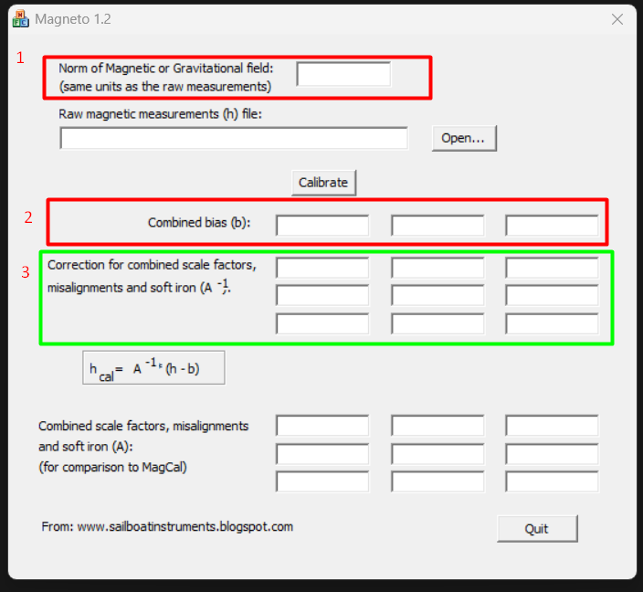
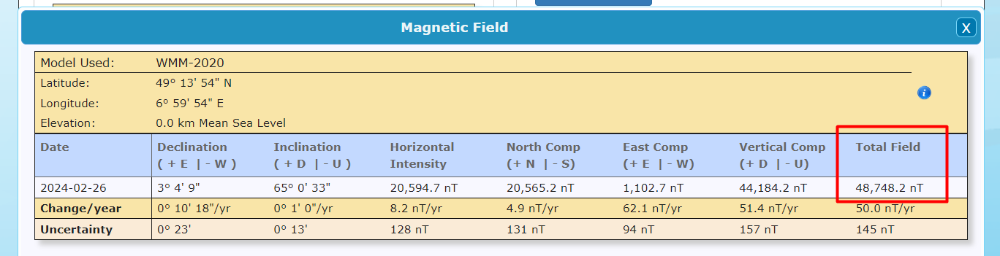

# TripleAdapt Sensors: Mahony AHRS Fusion Filter 

#### This is a implementation of the Mahony AHRS filter for the ICM 20948 IMU. The Mahony filter is a simple and efficient algorithm for sensor fusion. It is based on the work of Sebastian Madgwick and is a popular choice for sensor fusion in embedded systems.

#### The implementation of this filter for the SparkFun ICM 20948 was done by jremington and more can be found on his [GitHub](https://github.com/jremington/ICM_20948-AHRS)

#### The purpose of the Fusion Filter to allow for calibration of IMU data of the accelerometer, gyroscope and magnetometer which are error-prone due to bias of the sensors. The fitler aims to remove the bias and noise from the sensors to provide accurate orientation data.

#### More information about general IMU calibration can be found in this blog post [here](https://thecavepearlproject.org/2015/05/22/calibrating-any-compass-or-accelerometer-for-arduino/)

#### More specific information about Magnetometer calibration used here can be found [here](https://sailboatinstruments.blogspot.com/2011/08/improved-magnetometer-calibration.html)

# Calibration steps

### In order to calibrate the sensors we have to run the `calibration.cpp` script. It collects the bias offsets for the raw gyro, acclerometer and magnetometer readings. THE CALIBRATION ONLY NEEDS TO BE DONE ONCE FOR EACH SENSOR INSIDE ITS ENCLOSURE WITH THE BATTERY. Collecting the bias data involves the following steps

### Collecting bias offsets for the gyroscope:
#### The sensor is placed on a flat surface and the bias offsets are collected for the x, y and z axis. The offsets will be printed into the serial monitor.

### Collecting bias offsets for the accelerometer and magnetometer:
#### 1. The sensor is moved slowly and then held in certain fixed position for all three axes. A demonstration for taking measurements can be seen in this [video](https://www.youtube.com/watch?v=-1tmYPE7MAQ&list=WL&index=3&t=266s) starting from 2:35. 

#### 2. The raw accelerometer and magnetometer readings printed into the serial monitor. These readings must be copied and saved into a CSV or tab demilited text file. The python scirpt `parse_calibration_data.py` is provided that can parse the input file and write the scaled accelerometer and magnetometer readings into two separated text files. 

#### 3. Inorder to calculate the bias offsets for the accelrometer and gyroscope we use the software Magneto developed by the Sailboat Instruments. The software can be downloaded from [here](https://sailboatinstruments.blogspot.com/2011/09/improved-magnetometer-calibration-part.html). Magneto requires the readings for the magnetometer or accelerometer to be provided as tab delimited text files and then calcualtes the bias offsets as well as coffecients for the correction matrix.

### Calibration of the magnetometer

#### Set the value in 1 ("Norm of Maganetic or Graviation field") to the "Total Field" value seen [here](https://www.ngdc.noaa.gov/geomag/calculators/magcalc.shtml#igrfwmm) based on your location. MAKE SURE TO CONVERT THIS FROM NANOTESLA TO MICROTESLA! 

#### This will then generate the "Combined Bias" in 2 and generate the coefficients for the correction matrix in 3 as shown in the screenshot. These values are to be copied and set in the main script. Also note the magnetic declination value for your location and set it in the main script as well.

### Calibration of the accelerometer
#### The same steps apply for the accelrometer with only one notable change where when using the Magneto software we set the field in 1 ("Norm of Maganetic or Graviation field") to 1( as in 1g for accelometer readings). The combined bias and coefficients for the correction matrix are again producted and set in the main script.

#### Once everything has been set in the main script, the sensor is ready to be used for data collection. The sensor is placed in the desired location and the main script is run. The sensor will then collect the raw data and apply the calibration to provide accurate orientation data.